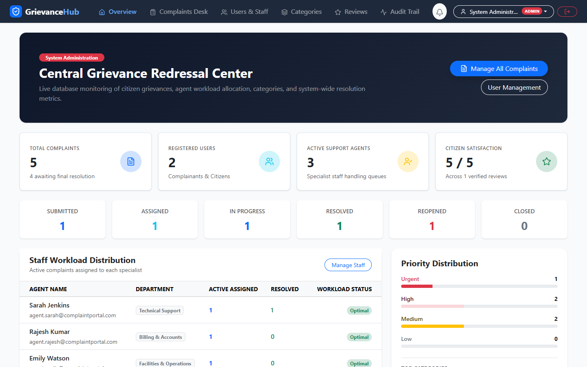
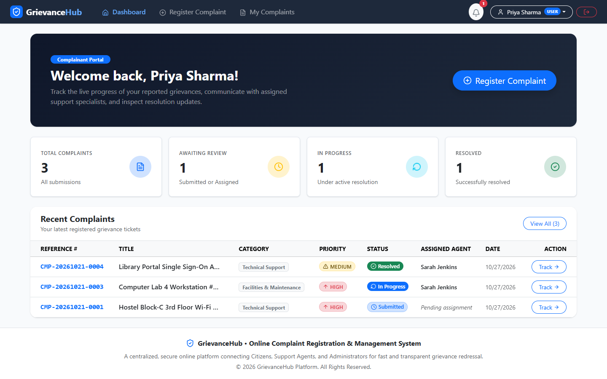
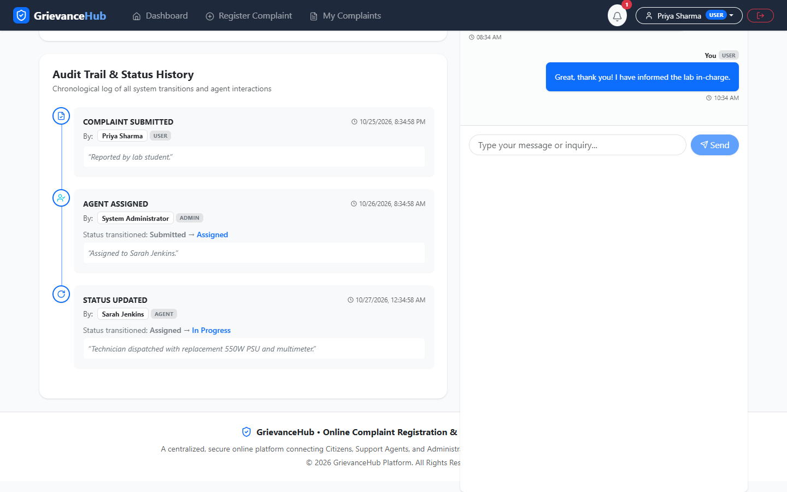
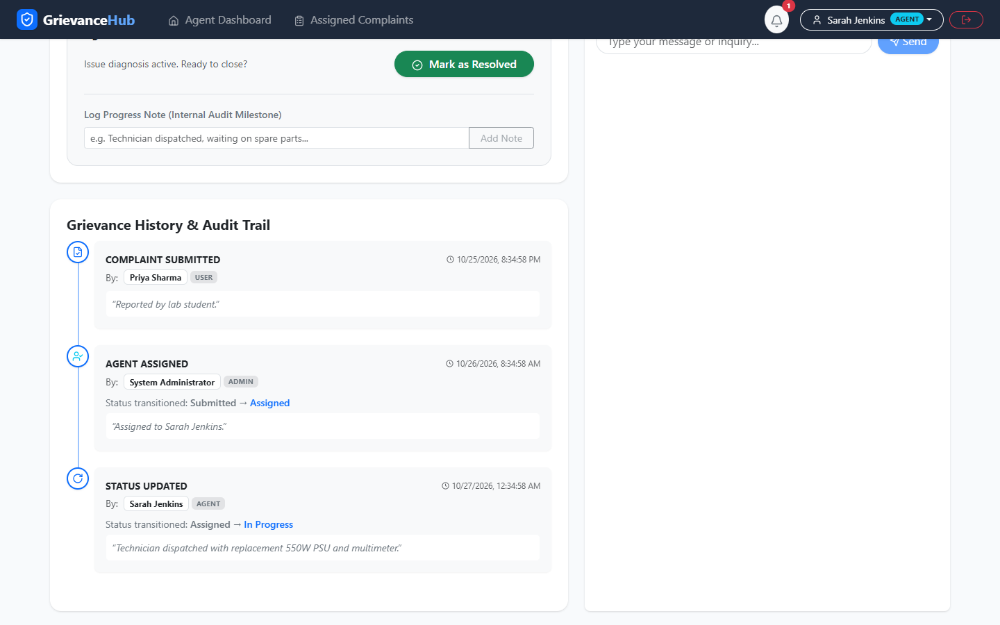
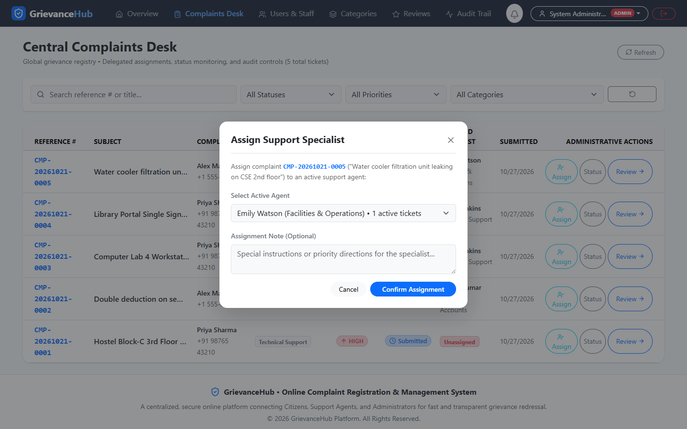
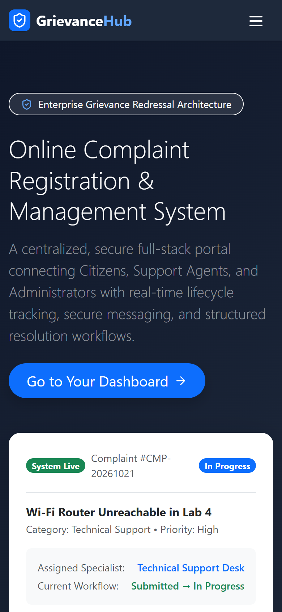
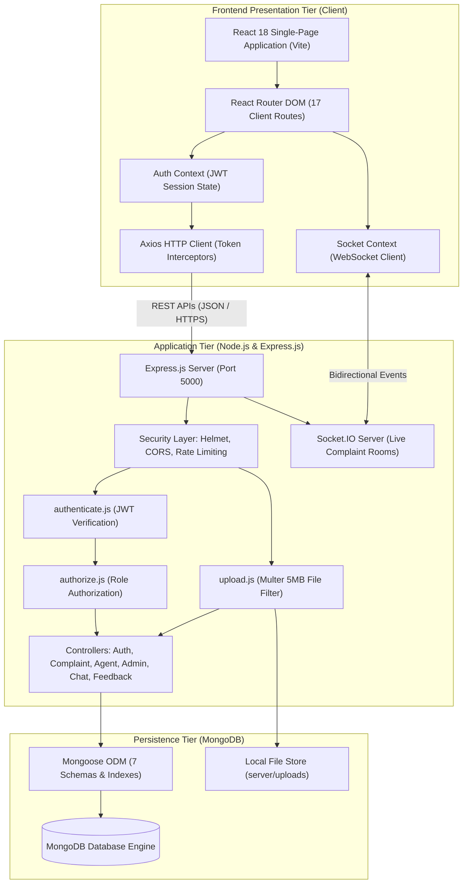
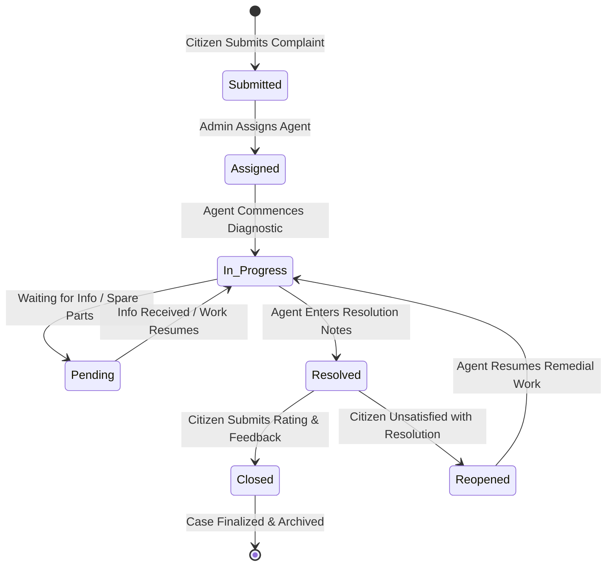

<div align="center">

# 🏛️ Online Complaint Registration & Management System
### *GrievanceHub — Centralized Academic & Enterprise Redressal Platform*

[](https://github.com/MDAARIF-2003/Online-Complaint-Registration)
[](https://react.dev/)
[](https://nodejs.org/)
[](https://socket.io/)
[-brightgreen?style=for-the-badge&logo=jest&logoColor=white)](https://github.com/MDAARIF-2003/Online-Complaint-Registration)
[](LICENSE)

<br/>

**A full-stack, enterprise-grade grievance management platform built for college capstone evaluation.**  
Connects **Citizens/Students**, **Department Support Agents**, and **System Administrators** into an auditable, secure, and transparent redressal lifecycle with real-time WebSocket communication, strict state-machine controls, and cryptographic audit trails.

[🚀 Quick Start](#-quick-start--setup-guide) •
[👥 Demo Accounts](#-pre-configured-demo-accounts) •
[📸 Live Screenshots](#-system-interface-showcase) •
[📊 Architecture](#-system-architecture) •
[📑 Project Documentation](#-academic-documentation--reports) •
[📡 API Reference](#-rest-api-documentation)

---

</div>

## 🌟 Key System Capabilities

### 👤 1. Citizen / Complainant Module
- **Self-Service Registration & JWT Authentication:** Cryptographically salted credentials with bcrypt (10 rounds) and HttpOnly session cookies.
- **Structured Grievance Submission:** Multi-field complaint filing with dynamic category validation, priority selection (`LOW`, `MEDIUM`, `HIGH`, `URGENT`), and 5MB attachment uploads.
- **Reference Code Generator:** Automated generation of human-readable tracking identifiers (`CMP-YYYYMMDD-XXXXXX`).
- **Interactive Lifecycle Audit Trail:** Transparent reverse-chronological timeline showing every status change, actor, and timestamp.
- **Real-Time Discussion Thread:** WebSocket-powered chat window connected directly to the assigned technician.
- **Post-Resolution Rating & Feedback:** Citizen satisfaction ratings (1–5 integer stars) with review comments and single-feedback enforcement.
- **Reopen Workflow:** Permitted reopening of resolved grievances with a mandatory justification reason.

### 🛠️ 2. Support Agent Module
- **Specialized Support Queue:** Workload filtered by department (Technical Support, Billing & Accounts, Facilities & Operations).
- **Enforced State Machine:** Permitted transitions only (`Assigned` &rarr; `In Progress` &rarr; `Resolved` or `Pending`).
- **Remedial Progress Notes:** Ability to log intermediate internal milestones without changing complaint status.
- **Mandatory Resolution Summaries:** Requires comprehensive remedial writeups prior to resolving tickets.
- **Real-Time Citizen Chat:** Bidirectional chat with complainants for instant clarifications and photo evidence.

### 🛡️ 3. Administrator Governance Module
- **Executive Analytics Dashboard:** Dynamic MongoDB aggregations displaying resolution rates, 7 status buckets, priority distributions, and category counts.
- **Live Agent Workload Balancer:** Modal dialog showing real-time agent ticket allocations to prevent technician burnout.
- **User & Staff Provisioning:** Administrative creation of Support Agent and Administrator accounts directly from the UI.
- **Category Management:** Dynamic grievance category creator with instant active/deactive toggle switches.
- **Immutable Audit Trail:** Cryptographic logging of administrative actions, actor roles, IP addresses, and timestamps.
- **Feedback Quality Reports:** Centralized review table aggregating all citizen satisfaction scores and reviews.

---

## 📸 System Interface Showcase

<div align="center">

### 1. Executive Analytics Dashboard
*Comprehensive KPI monitors, status distribution bars, category analytics, and support technician workload metrics.*
<br/>


<br/><br/>

### 2. Complainant Portal & Dashboard
*Personalized citizen dashboard displaying active grievance counters, quick actions, and recent activity.*
<br/>


<br/><br/>

### 3. Grievance Audit Trail & Real-Time Communication
*Detailed complaint dossier showing chronological lifecycle history and WebSocket chat thread.*
<br/>


<br/><br/>

### 4. Support Agent Workload & Resolution Controls
*Agent resolution panel with diagnostic transition controls, milestone logger, and resolution report editor.*
<br/>


<br/><br/>

### 5. Multi-Criteria Complaint Register & Assignment Modal
*Central administrative ticket ledger with multi-parameter filter bar and dynamic agent assignment modal.*
<br/>


<br/><br/>

### 6. Mobile Responsive Interface
*Responsive layout optimized for smartphones (390 × 844 px) with touch navigation and stacked cards.*
<br/>


</div>

---

## 🏗️ System Architecture



---

## 🔄 Complaint Lifecycle State Machine



---

## 👥 Pre-Configured Demo Accounts

The database comes pre-seeded with realistic demonstration accounts across all roles:

| Role | Name | Email | Password | Department / Scope |
|:---|:---|:---|:---|:---|
| 👑 **Administrator** | System Administrator | `admin@complaintportal.com` | `Admin@12345` | Global System Administration |
| 🛠️ **Support Agent** | Sarah Jenkins | `agent.sarah@complaintportal.com` | `Agent@12345` | Technical Support |
| 🛠️ **Support Agent** | Rajesh Kumar | `agent.rajesh@complaintportal.com` | `Agent@12345` | Billing & Accounts |
| 🛠️ **Support Agent** | Emily Watson | `agent.emily@complaintportal.com` | `Agent@12345` | Facilities & Operations |
| 👤 **Citizen User** | Priya Sharma | `user.priya@complaintportal.com` | `User@12345` | Student / Complainant |
| 👤 **Citizen User** | Alex Martinez | `user.alex@complaintportal.com` | `User@12345` | Citizen / Complainant |

> *Tip: You can also register new citizen accounts instantly from the registration page, or provision new agents from the Admin User Management panel.*

---

## 🚀 Quick Start & Setup Guide

### System Prerequisites
- **Node.js:** v18.x or newer (Tested on `v24.19.0`)
- **Package Manager:** npm v9+ (Tested on `11.17.0`)
- **Database:** MongoDB (Local service or embedded persistent fallback)

### Step 1: Clone the Repository
```bash
git clone https://github.com/MDAARIF-2003/Online-Complaint-Registration.git
cd Online-Complaint-Registration
```

### Step 2: Install All Dependencies
```bash
npm run install-all
```
*(Automatically installs dependencies for the root orchestrator, frontend client, and backend server).*

### Step 3: Seed Realistic Demo Data
```bash
npm run seed
```
*(Populates all demo users, categories, active complaints, live chat threads, notifications, and audit records).*

### Step 4: Run the Application
Launch both backend and frontend concurrently with a single command:
```bash
npm run dev
```

Alternatively, run in separate terminal windows:
```bash
# Terminal 1: Backend API (Port 5000)
npm run start:server

# Terminal 2: Frontend Web App (Port 5173)
npm run start:client
```

Open **`http://localhost:5173`** in your browser to access the portal!

---

## 🧪 Automated Testing & QA Evidence

The project includes two independent test suites validating functionality and defect resolutions:

```bash
# Run Master Integration Test Suite (20/20 Passing)
npm test

# Run Targeted QA Defect Verification Suite (11/11 Passing)
node server/test/qa-defect-hunt.js

# Build Frontend Bundle for Production
npm run build
```

### Verification Test Summary
- **Total Test Checks:** **37 / 37 Passed (100% Pass Rate)**
- **Open Defects:** **0** (All 7 identified defects fixed and verified)
- **Frontend Build:** Compiled 1,713 modules cleanly in 22.98s via Vite 6.

---

## 📑 Academic Documentation & Reports

The project repository includes a complete academic documentation package prepared for B.Tech CSE Capstone evaluation:

```
Documentation/
├── 1. Requirement Analysis/
│   ├── Data_Flow_Diagram_and_User_Stories.docx
│   ├── Solution_Requirements.docx
│   └── Technology_Stack_Architecture_and_Stack.docx
├── 2. Brainstorming and Ideation/
│   ├── Brainstorming_Idea_Generation_Prioritization.docx
│   ├── Define_Problem_Statements.docx
│   └── Empathy_Map_Canvas.docx
├── 3. Project Planning/
│   └── Project_Planning_Online_Complaint_Registration.docx
├── 4. Project Design/
│   ├── Problem_Solution_Fit.docx
│   ├── Proposed_Solution.docx
│   └── Solution_Architecture.docx
├── 5. Project Development/
│   ├── UAT_Execution_Document.docx       # Formal 12-scenario UAT document
│   └── UAT_Defect_Register_and_Bug_Tracking.md # Bug tracking & resolution register
└── 6. Project Report/
    └── Online_Complaint_Registration_Report.docx # Complete 21-Page Capstone Report
```

- **Complete Evidence Archive:** [`documentation_assets.zip`](documentation_assets.zip) (Contains all 21 raw PNG screenshots, system audit report, and diagram sources).

---

## 📡 REST API Documentation

### 🔐 Authentication (`/api/auth`)
| Method | Endpoint | Access | Description |
|:---|:---|:---|:---|
| `POST` | `/api/auth/register` | Public | Registers citizen account (forces role `USER`) |
| `POST` | `/api/auth/login` | Public | Authenticates credentials; returns JWT token & cookie |
| `POST` | `/api/auth/logout` | Public | Clears HttpOnly session cookie |
| `GET` | `/api/auth/me` | Authenticated | Retrieves current logged-in user profile |
| `PATCH`| `/api/users/me` | Authenticated | Updates personal information or password |

### 📝 Grievance Redressal (`/api/complaints`)
| Method | Endpoint | Access | Description |
|:---|:---|:---|:---|
| `POST` | `/api/complaints` | `USER` | Submits complaint with category validation & attachments |
| `GET` | `/api/complaints` | Authenticated | Lists complaints scoped to role with search/filter/pagination |
| `GET` | `/api/complaints/:id` | Authorized | Retrieves full complaint record, agent info, and attachments |
| `GET` | `/api/complaints/:id/history` | Authorized | Returns chronological history timeline audit steps |
| `POST` | `/api/complaints/:id/reopen` | `USER` (Owner) | Reopens resolved complaint; resets `resolvedAt` to null |
| `GET` | `/api/complaints/:id/messages`| Authorized | Retrieves discussion thread messages |
| `POST` | `/api/complaints/:id/messages`| Authorized | Sends message on complaint thread (blocked on Closed) |
| `POST` | `/api/complaints/:id/feedback`| `USER` (Owner) | Submits 1–5 integer star rating and feedback review |
| `GET` | `/api/complaints/:id/feedback`| Authorized | Retrieves feedback evaluation for resolved complaint |

### 🛠️ Support Agent Queue (`/api/agent`)
| Method | Endpoint | Access | Description |
|:---|:---|:---|:---|
| `GET` | `/api/agent/dashboard` | `AGENT` | Agent dashboard metrics and active workload counters |
| `GET` | `/api/agent/complaints` | `AGENT` | Filterable queue of complaints assigned to logged-in agent |
| `PATCH`| `/api/agent/complaints/:id/status`| `AGENT` | Executes validated state transition (`In Progress`, `Resolved`) |
| `POST` | `/api/agent/complaints/:id/notes` | `AGENT` | Logs progress milestone note to history |

### 👑 Administration & Governance (`/api/admin`)
| Method | Endpoint | Access | Description |
|:---|:---|:---|:---|
| `GET` | `/api/admin/dashboard` | `ADMIN` | Executive analytics, status distribution, and workload monitors |
| `GET` | `/api/admin/users` | `ADMIN` | User accounts directory with role/status filters |
| `POST` | `/api/admin/users/create-staff` | `ADMIN` | Provisions Support Agent or Administrator accounts |
| `PATCH`| `/api/admin/users/:id/status` | `ADMIN` | Toggles account status (`ACTIVE` / `INACTIVE`) |
| `PATCH`| `/api/admin/users/:id/role` | `ADMIN` | Promotes user role or updates department |
| `GET` | `/api/admin/agents` | `ADMIN` | Lists active agents with current workload counts |
| `POST` | `/api/admin/complaints/:id/assign`| `ADMIN` | Assigns/reassigns complaint (blocked on Closed) |
| `PATCH`| `/api/admin/complaints/:id/status`| `ADMIN` | Administrative status override with audit logging |
| `GET` | `/api/admin/categories` | Public/Auth | Returns active complaint categories |
| `POST` | `/api/admin/categories` | `ADMIN` | Creates new complaint category |
| `PATCH`| `/api/admin/categories/:id/toggle` | `ADMIN` | Toggles category active status |
| `GET` | `/api/admin/feedback` | `ADMIN` | Central feedback review report table |
| `GET` | `/api/admin/audit-logs` | `ADMIN` | Paginated immutable administrative audit trail |

---

## 👨‍💻 Project Authorship & Evaluation Details

- **Author & Developer:** **MD AARIF IDRASI**
- **Email:** `rajakarma021@gmail.com`
- **GitHub:** [@MDAARIF-2003](https://github.com/MDAARIF-2003)
- **Academic Degree:** B.Tech Computer Science & Engineering (3rd Year)
- **Course / Project:** Individual Academic Capstone Project (2026)
- **Repository:** [https://github.com/MDAARIF-2003/Online-Complaint-Registration](https://github.com/MDAARIF-2003/Online-Complaint-Registration)

---

<div align="center">
  <b>Built with ❤️ using the MERN Stack • Designed for Academic & Enterprise Excellence</b>
</div>
