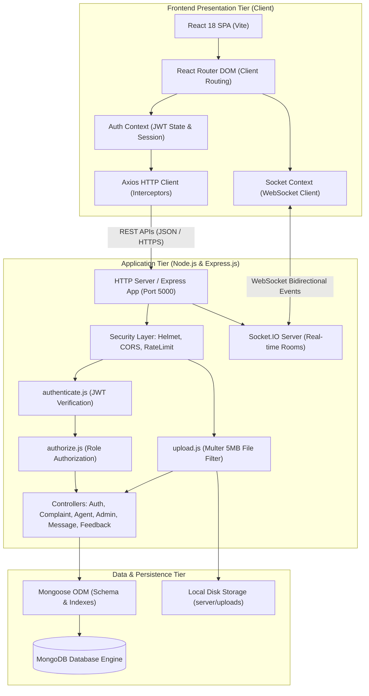
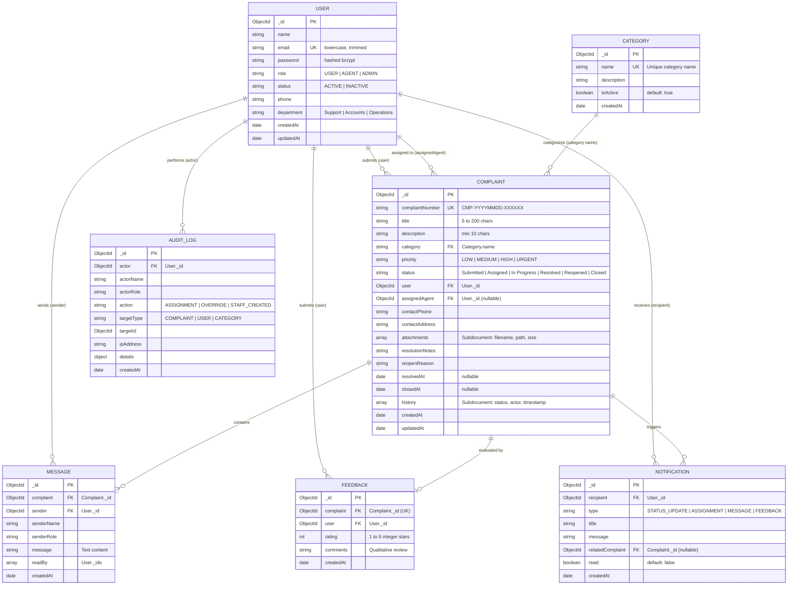
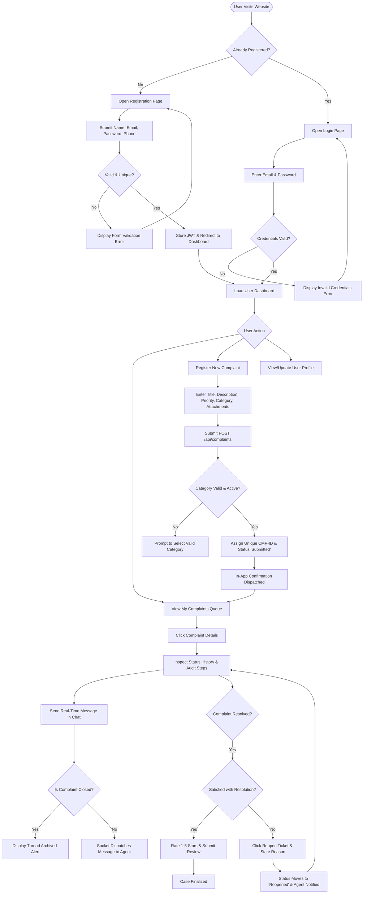
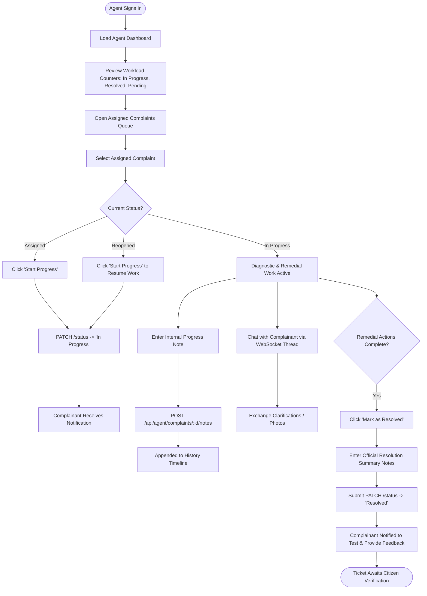

# System Architectural & Workflow Diagram Evidence
# Online Complaint Registration and Management System (*GrievanceHub*)

**Author / Project Lead:** MD AARIF IDRASI  
**Document Purpose:** Grounded architectural specifications, entity relationships, and workflow diagrams for direct inclusion in the 21-page academic project report.  
**Diagram Format:** Mermaid diagram code blocks and textual relationship specifications verified against the implemented codebase.  

---

## 1. Technical Architecture Diagram

The system employs a 3-tier MERN (MongoDB, Express, React, Node) architecture augmented with Socket.IO for real-time bidirectional communication and Multer for multipart file storage.



---

## 2. Entity-Relationship (ER) Diagram

All entities, relationships, foreign keys, and cardinalities below are derived directly from the Mongoose schemas in `server/src/models/`:



---

## 3. Complainant / Citizen User Flow

This diagram describes the complete user journey for an ordinary citizen from registration through complaint resolution and feedback.



---

## 4. Support Agent Workflow

This diagram outlines how support technicians interact with their queue, diagnose issues, record progress notes, communicate with complainants, and submit resolution summaries.



---

## 5. Administrator Workflow

This diagram describes the system administrator's administrative governance, complaint routing, user account management, and analytical oversight.

```mermaid
flowchart TD
    AdminLogin([Administrator Signs In]) --> AdminDashboard[Load Executive Dashboard]
    AdminDashboard --> MetricsAudit[Review Platform Metrics, SLA Rates & Workloads]
    
    AdminDashboard --> NavChoice{Admin Task}
    
    NavChoice -- Manage Complaints --> AllComplaints[Open Master Complaints Register]
    AllComplaints --> FilterTickets[Filter by Status, Category, Priority, or Search Query]
    FilterTickets --> IdentifyUnassigned[Locate 'Submitted' Unassigned Complaints]
    IdentifyUnassigned --> ClickAssign[Click 'Assign' Button]
    ClickAssign --> LoadAgents[Fetch Active Support Agents & Current Workloads]
    LoadAgents --> SelectAgent[Select Appropriate Agent & Optional Note]
    SelectAgent --> PostAssign[POST /api/admin/complaints/:id/assign]
    PostAssign --> UpdateStatusAssigned[Ticket Status Moves to 'Assigned']
    UpdateStatusAssigned --> SendAlerts[Agent & Citizen Receive In-App Notifications]
    
    NavChoice -- Manage Users --> UserDirectory[Open User Management Page]
    UserDirectory --> UserActions{User Action}
    UserActions --> ProvisionStaff[Click 'Create Staff Account']
    ProvisionStaff --> FillStaffForm[Enter Name, Email, Password, Role (AGENT/ADMIN), Dept]
    FillStaffForm --> CreateStaffAPI[POST /api/admin/users/create-staff]
    CreateStaffAPI --> StaffActive[New Staff Account Activated]
    
    UserActions --> ToggleStatus[Toggle Citizen / Agent Status (ACTIVE / INACTIVE)]
    UserActions --> ChangeRole[Update Role or Department Assignment]
    
    NavChoice -- Configure Categories --> CategoryManager[Open Category Management Page]
    CategoryManager --> AddCat[Add New Grievance Category & Description]
    CategoryManager --> ToggleCat[Toggle Category Active State]
    
    NavChoice -- Quality Review --> FeedbackPage[Open Citizen Feedback Reports]
    FeedbackPage --> InspectStars[Inspect 1-5 Star Ratings, Reviews & Timestamps]
    
    NavChoice -- Compliance Audit --> AuditLogViewer[Open System Audit Trail]
    AuditLogViewer --> ReviewLogs[Inspect Immutable IP, Actor, Timestamp & Action Logs]
```

---

## 6. MVC / Component Architecture

This diagram demonstrates how each code module aligns with the standard Model-View-Controller paradigm:

```mermaid
flowchart LR
    subgraph View ["View Layer (client/src)"]
        Pages["Pages (Landing, Login, Dashboard, Complaints, Users)"]
        Components["Components (Navbar, StatusBadge, Timeline, ChatWindow)"]
        Context["Context (AuthContext, SocketContext)"]
        Pages --- Components
        Pages --- Context
    end

    subgraph Controller ["Controller Layer (server/src/controllers)"]
        AuthController["authController.js"]
        ComplaintController["complaintController.js"]
        AgentController["agentController.js"]
        AdminController["adminController.js"]
        MessageController["messageController.js"]
        FeedbackController["feedbackController.js"]
    end

    subgraph MiddlewareRouter ["Routing & Middleware (server/src)"]
        Routes["Routes (auth, complaint, agent, admin, notification)"]
        Middlewares["Middleware (authenticate, authorize, upload, errorHandler)"]
        Routes --- Middlewares
    end

    subgraph Model ["Model Layer (server/src/models)"]
        M_User["User.js"]
        M_Complaint["Complaint.js"]
        M_Message["Message.js"]
        M_Notification["Notification.js"]
        M_Category["Category.js"]
        M_Feedback["Feedback.js"]
        M_AuditLog["AuditLog.js"]
    end

    View -->|"HTTP REST Requests / JSON"| Routes
    Middlewares --> Controller
    Controller -->|"ODM Operations"| Model
    Model -->|"Query Results"| Controller
    Controller -->|"JSON Response"| View
```


